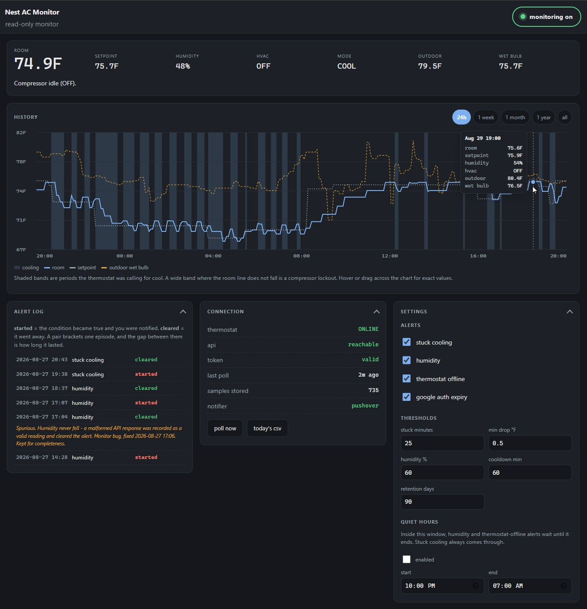
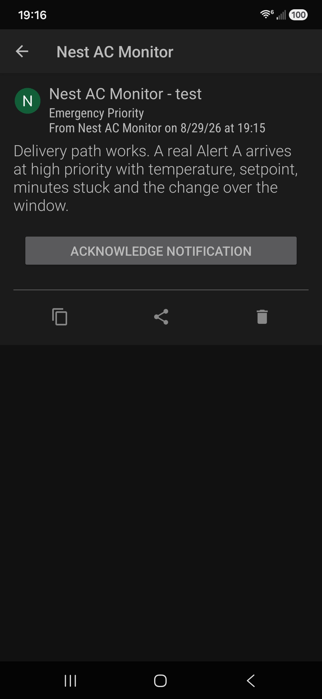

# Nest AC Monitor

**Your thermostat cannot tell you the compressor has stopped. This can.**

A read-only monitor for a failure the thermostat is structurally blind to. The
compressor stops, the blower keeps running, and the apartment sounds exactly
like it is cooling while it warms up. People discover it hours later, usually by
waking up hot.

It runs on Cloudflare's free tier, polls your Nest every five minutes, pushes an
alert to your phone, and keeps a timestamped record you can hand to a
technician. That record turned out to be the more useful half.

---

## Before you read further: you need a Google Nest thermostat

This reads your thermostat through Google's Smart Device Management API, so
there is a hard prerequisite. **No Nest, no monitor.**

**You need all three:**

| | |
|---|---|
| **A Google Nest thermostat** | Migrated to a Google Account rather than a legacy Nest account. Free way to check: if the thermostat appears in the **Google Home** app, you are fine. |
| **A personal `@gmail.com` account** | Google **Workspace** accounts cannot register for Device Access at all. The console will not load and the OAuth flow cannot complete. |
| **A phone you want alerts on** | Android or iOS. |

**This is for you if** you have a Nest, you have air conditioning that
occasionally stops cooling without telling you, and you would rather find out in
five minutes than five hours.

**This is not for you if** you have any other thermostat. The detection logic in
`src/detect.js` is device-agnostic and would port to anything that reports an
ambient temperature and a commanded heating/cooling state, but nothing here
works with another brand as shipped.



*The 24-hour view. Shaded bands are periods the thermostat was calling for cool.
Where the room line does not fall inside one, the compressor has stopped. The
annotated row in the alert log is a false recovery caused by a bug in this
software, kept and explained rather than deleted.*

---

## What it costs

| | |
|---|---|
| Google Device Access registration | **$5, one time** |
| Pushover phone notifications | **$5, one time** (30-day free trial first) |
| Cloudflare Workers + D1 hosting | **$0**, comfortably inside the free tier |
| Weather data (Open-Meteo) | **$0**, no account, no API key |
| **Total** | **$10, once. No subscription.** |

288 polls a day against Cloudflare's free limits of 100,000 requests and 100,000
D1 writes. Nothing here grows into a bill.

### A note on the $5 for notifications

This project originally used **ntfy.sh**, which is free and needs no account. It
worked perfectly while the monitor ran on a home PC, and broke as soon as it
moved to Cloudflare.

**ntfy's free tier meters its quota by IP address rather than by account.** A
Cloudflare Worker sends from Cloudflare's shared egress addresses, so that
250-messages-per-day allowance is shared with every other customer publishing
from the same IP, and strangers exhaust it. The symptom was `HTTP 429` after
twelve messages, while the identical request from a home connection returned
`200`. Creating an ntfy account and access token did not help. The account
object reports `"limits": {"basis": "ip"}`, and only a paid plan changes that.

The failure is also intermittent and silent, so alerts arrive whenever the shared
quota happens to have room. An alerting system that becomes unreliable in
proportion to how much you need it is worse than one that is plainly absent.

**So the project now uses [Pushover](https://pushover.net)**, at $4.99 one time,
with a per-account quota of 10,000 messages a month, and it works from a cloud
host. Both backends ship. ntfy remains a good choice if you run this on your own
machine. Full story in [docs/03-notifications.md](docs/03-notifications.md).

## What you get

- **Runs in the cloud, not on your computer.** No PC that has to stay awake, no
  scheduled task, nothing to restart. A monitor running inside the apartment
  cannot tell you the apartment lost power or internet, because it dies with the
  thing it is watching.
- **Alerts on your phone**, at a priority you choose. Wake you at 3 AM, or leave
  the warning waiting in the morning.

  

- **A dashboard you can open from anywhere**, on a phone or a laptop, behind
  Google sign-in.
- **A record that accumulates.** Every five minutes, indefinitely.

---

## The failure it catches

Air conditioners have safety switches that cut the compressor and leave the fan
running. On a water-source heat pump, common in apartment towers where your unit
rejects heat into a building-wide water loop instead of its own outdoor
condenser, the trip can come from high refrigerant pressure or from a blocked
condensate drain. Both produce an identical symptom.

A thermostat reports the state it **commanded**, never whether the compressor is
actually turning. Nest's Energy History draws a solid bar for "calling for cool"
whether the compressor is working, losing, or dead.

**The inference:** sustained `COOLING` plus a room that is not getting cooler
means the compressor is not running. From outside the unit that is the only
signal available, and it is enough.

### What it watches for

| Alert | Condition |
|---|---|
| **Stuck cooling** | Calling for cool for 25 minutes with less than 0.5 °F of drop **over the most recent 25 minutes** |
| **Humidity** | Indoor humidity ≥60% on two consecutive polls. The coil has stopped removing moisture, which is often the earliest sign |
| **Thermostat offline** | Unreachable twice running, or three consecutive API failures |
| **Auth expiry** | Google rejected the stored credentials. Without this the monitor goes blind silently |

Each fires once, sends one recovery notification when it clears, and never
repeats more than once an hour. Quiet hours can hold the minor alerts until
morning. The stuck-cooling alert is never held.

### Why the window slides

The stuck-cooling check measures the **most recent** 25 minutes rather than the
whole run. A unit that cools well for 25 minutes and then quits would otherwise
hide behind its own good start, looking healthier the longer it sat dead.

This is not hypothetical. It is the first real failure this software missed, and
the fix is the single most important line of logic in it.

---

## The log is the point

Alerts wake you once. The record is independent evidence of **how often and at
what hours** the unit fails to hold setpoint, with outdoor temperature, humidity,
dew point and **wet bulb** in the same row.

Wet bulb matters because a cooling tower cannot reject heat below the ambient wet
bulb, so tower capacity is governed by it. If your failures cluster at high wet
bulb, the constraint is the building's tower rather than your apartment. If they
do not, that is worth knowing too, and either way it is a much harder claim to
wave away than "my apartment got hot."

Daily CSV export is one click, in Fahrenheit with local timestamps first, meant
to be handed to a technician or attached to an email rather than parsed.

Readings are pruned after 90 days. **Alerts are never pruned.**

---

## Read-only, by design

**The application never sends a command to the thermostat.** Every call is a
read. There is no command path in the code and there should not be one.

The reason is that a bug in this software then cannot leave your apartment
uncooled, which is worth more than any feature a write path would buy.

---

## Getting started

Roughly an hour, most of it waiting on Google's consoles.

1. **[Device Access setup](docs/01-device-access-setup.md)** covers the $5 Google
   registration, OAuth, and getting your first live reading. It includes the
   traps: Workspace accounts cannot do this at all, and an app left in "Testing"
   status expires its refresh token every 7 days.
2. **[Deploy to Cloudflare](docs/02-cloudflare-deploy.md)** covers D1, the
   Worker, the cron trigger, secrets, and putting Google sign-in in front of it.
3. **[Notifications](docs/03-notifications.md)** covers Pushover and ntfy, and
   why the free option is unreliable from a cloud host.

---

## What is in here

```
src/            the Cloudflare Worker
  detect.js       the alert logic. Pure functions, no I/O - read this one first
  db.js           D1 access, settings, retention
  sdm.js          Google Smart Device Management. Read-only, no command path
  weather.js      Open-Meteo, for the outdoor wet bulb
  notify.js       Notifier interface - Pushover and ntfy
  index.js        cron handler, HTTP router, CSV export
  ui.js           the dashboard, inlined
test/           35 assertions, plain node, no database or network needed
tools/          one-time OAuth bootstrap, run before you deploy
oauth-pages/    two static pages Google requires before it will let you publish
docs/           setup guides and the original design spec
ASSIGNMENT.md   a complete brief for rebuilding this from scratch with an AI agent
```

`detect.js` is deliberately free of I/O so the whole state machine runs under
plain `node` with no database and no network:

```bash
node test/detect.test.mjs
```

Every case in that file is either a requirement from the spec or **a bug that
actually happened in production**, including:

- a run that cooled and then stalled, which the original logic could never detect
- a malformed API response stored as a valid reading, which fired a false
  *recovery*, telling you the AC came back when it had not
- an alert lost entirely because the row was only written when the push
  notification succeeded

---

## Limits

**It records the symptom without diagnosing the cause.** Entering water
temperature, discharge pressure against the high-pressure cutout, which safety
switch actually opened, and the control board's stored fault history are all
invisible to a thermostat. Those come from a technician with gauges.

What this gives you is the timestamped record that gets the visit booked for the
right hour, and that a building manager cannot answer with "readings are in an
acceptable range."

**One thermostat.** Multi-device support was a deliberate non-goal.

---

## Built with Claude Code

This was built in a single working session, alongside the failure it was written
to catch. The first real lockout was detected about four hours after the first
line of code, and two of the bugs now in the test suite were found by the
software being wrong about a failure that was happening at that moment.

[`ASSIGNMENT.md`](ASSIGNMENT.md) is a complete brief for reproducing it: the
architecture, the traps, the acceptance criteria, and the details that are not
obvious until something has already gone wrong at 2 AM.

## Licence

MIT. See [LICENSE](LICENSE).
